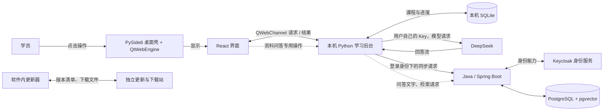

# 总架构：MentorFlow 的主要部分怎样协作

基线是仓库 `e61fd00d`：以下讲的是当前桌面版和线上服务。标题后的“常被问／偶尔问／基本不问”表示学习优先级判断，不是统计出来的面试频率。想象一间自习室：桌面窗口像前台，React 是办事屏，本机 Python 是老师和记账员，Java 服务是远处的校务办公室，更新站像独立的软件下载柜。比喻只帮助理解分工，真实系统靠程序接口、数据库和网络传数据，不会有真人跑腿。

## 1. 前台、办事屏和本机老师分工接待｜常被问

先把界面和本机后台接好。桌面程序用 PySide6 打开一个 QtWebEngine 窗口，窗口里的 React 页面负责菜单、课程卡片和课堂画面。 **一句话层。**

页面要读本地课程或发起上课动作时，会通过 QWebChannel 把请求交给 Python；Python 做业务处理，再把结果或逐段回答送回页面显示。 **三句话层。**

这像前台把填写好的办事单交给老师处理，处理结果再回到屏幕；但“办事单”只是比方，实际交接是有方法名、参数和返回消息的 JSON 请求，并不是网页能随便改后台文件。 **深一层。**

图中的接口和存储说明的是程序关系，不表示每次点击都会访问所有盒子：普通课堂主要由本机 Python 和模型配合，Java 同步及资料检索是不同请求，更新器则走另一条服务链。 看到的都是窗口里的按钮，实际请求可能只走其中一条服务链。

你可以这样跟面试官说：软件打开后，PySide6 和 QtWebEngine 承载 React 页面。页面通过 QWebChannel 把操作交给本机 Python，Python 返回数据或回答流给界面。前端负责交互展示，学习规则和数据处理在 Python 侧。

### 面试官问：桌面程序里前端和 Python 怎么配合？
- 桌面程序用 PySide6 打开一个 QtWebEngine 窗口，窗口里的 React 页面负责菜单、课程卡片和课堂画面。
- 页面要读本地课程或发起上课动作时，会通过 QWebChannel 把请求交给 Python；Python 做业务处理，再把结果或逐段回答送回页面显示。
- 实际交接是有方法名、参数和返回消息的 JSON 请求，并不是网页能随便改后台文件。
## 2. 本机老师把课程和进度记在自己的账本里｜常被问

课程和进度先存本机账本。每个账号在本机有自己的 SQLite 课程库；它叫 `course.sqlite3`。 **一句话层。**

Python 的课程服务读取计划、课程资料和当前进度，课堂规则也在本机执行；SQLite 保存这些学习记录，程序通过事务把一组相关改动一起写入。 **三句话层。**

这像每个学员有自己的课程文件柜，老师在旁边记下做到哪一步；类比到此为止，SQLite 是嵌入软件的数据库文件，并非一个人在房间里，也不是服务器数据库。 **深一层。**

需要联网时，同步服务会把符合同步规则的学习记录送往 Java 服务；同步暂时失败时，本机记录仍保留，后续可以重试。 原始资料文件仍留在本机，不会因为课程进度同步就自动上传。

你可以这样跟面试官说：课程和进度先由本机 Python 管理，保存在每个账号自己的 SQLite 文件里。这样课堂操作有本地数据基础；联网同步失败时，已保存的本机记录仍在，之后可以重试。原始资料文件不会随进度一起自动上传。

### 面试官问：为什么课程数据先存在本机？
- 每个账号在本机有自己的 SQLite 课程库；它叫 `course.sqlite3`。
- SQLite 保存这些学习记录，程序通过事务把一组相关改动一起写入。
- 同步暂时失败时，本机记录仍保留，后续可以重试。
## 3. 上一节课时，页面、模型和服务器怎样接力｜常被问

一堂课会走过几条数据链。课堂请求和进度同步各自处理，不会把整件事都交给服务器。 **一句话层。**

学员点开当前小节，React 向 Python 请求课堂内容；Python 从本机课程数据取出要讲的内容，再把问题和所需上下文交给用户选定的模型。 **三句话层。**

模型由客户端直接连接 DeepSeek，使用用户自己的 API Key；模型回答以文字流回到 Python，再显示在 React 页面。 Java 不代替模型中转，也不负责生成每一堂课的回答。 **深一层。**

课堂状态由本机宿主按照用户的操作推进并保存；模型生成讲解文本供老师展示，不直接改学习状态。 应同步的记录再交给同步服务。同步服务通过 HTTPS 访问 Java 后端；Java 的 Spring Boot 接口使用登录身份处理账号和同步业务，身份由 Keycloak 提供验证，业务数据保存在 PostgreSQL。 Keycloak 负责确认“是谁在登录”，Java 负责按这个身份办理自己的业务；它不是课堂老师，也不替数据库保存课程表。 网络中断时，课堂本机记录不会因此消失；但服务器同步要等网络和登录状态恢复后再完成。

这好比老师现场讲课、学员自己的本子先记笔记，校务办公室之后收到需要共享的记录；比喻不意味着每句话都上传，模型回答和进度同步是两种单独的网络请求。

你可以这样跟面试官说：上一节课先由 React 把操作交给本机 Python。Python 取本地课程内容，用用户自己的 Key 直连 DeepSeek，再把回答显示给学员。宿主根据用户在课堂中的操作推进和保存进度，该同步的记录再由同步服务发给 Java；Keycloak 校验身份，Java 把业务数据写进 PostgreSQL。课堂请求和进度同步不是同一个请求。

### 面试官问：上一节课的数据经过哪些部分？
- React 向 Python 请求课堂内容；Python 从本机课程数据取出要讲的内容，再把问题和所需上下文交给用户选定的模型。
- 模型由客户端直接连接 DeepSeek，使用用户自己的 API Key；模型回答以文字流回到 Python，再显示在 React 页面。
- 课堂状态由本机宿主按照用户的操作推进并保存；模型生成讲解文本供老师展示，不直接改学习状态。
- 同步服务通过 HTTPS 访问 Java 后端；Java 的 Spring Boot 接口使用登录身份处理账号和同步业务，身份由 Keycloak 提供验证，业务数据保存在 PostgreSQL。
## 4. 资料问答和软件下载各走自己的门｜偶尔问

资料检索，软件更新分开。 **一句话层。**

学员主动打开资料问答时，客户端把选中资料的文字分块送到 Java；Java 在服务器端为文字建立检索索引，按问题找出相关片段，再把片段交还客户端。 这些向量存放在 PostgreSQL 的 pgvector 扩展中，它只服务资料检索，不参与普通课堂进度记录。 **三句话层。**

客户端仍用用户选择的模型和自己的 Key 生成回答；Java 负责存文字和找片段，不替模型写答案。资料问答会话保存在本机，上传的是文字，不是原文件。 **深一层。**

软件更新走另一条链：桌面更新器向独立更新站检查版本清单、取回所需文件并验证签名，再准备安装；该过程不依赖课堂请求或 RAG 检索。 下载站还提供安装程序入口；截至本篇核验基线记录（2026-10-18），线上软件内更新已到 2.0.25，下载站安装程序仍是 2.0.15。

所以自习室里“把一段资料交给校务柜台查找”只对应资料问答，“换一套软件”只对应更新；两件事都不是普通上一节课的必经步骤。

你可以这样跟面试官说：平常上课不必先经过资料问答。只有用户打开资料问答时，文字才上传到 Java 做检索，回答仍由客户端的模型生成；软件更新又是独立的一条链，更新器从更新站拿清单和文件并验签。课堂、资料检索、软件更新各有自己的入口。

### 面试官问：资料问答和课堂回答有什么区别？
- 资料检索，软件更新分开。
- 客户端把选中资料的文字分块送到 Java；Java 在服务器端为文字建立检索索引，按问题找出相关片段，再把片段交还客户端。
- Java 负责存文字和找片段，不替模型写答案。
- 软件更新走另一条链：桌面更新器向独立更新站检查版本清单、取回所需文件并验证签名，再准备安装；该过程不依赖课堂请求或 RAG 检索。
## 学习路线：不用背｜基本不问

记住这些分工就够了：桌面壳显示 React，Python 在本机负责课程和进度，模型由客户端用用户自己的 Key 直连，Java 处理同步和资料检索，更新器单独联系更新站；要追某个按钮，再沿图里的箭头找专题，不必背类名。
